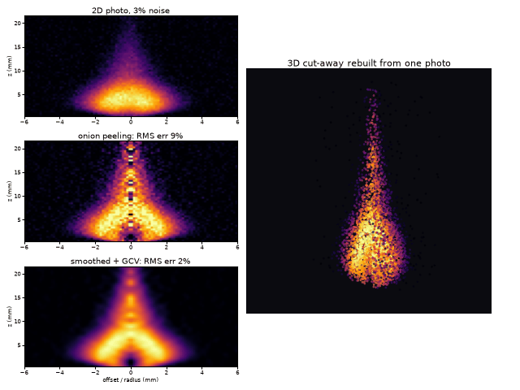
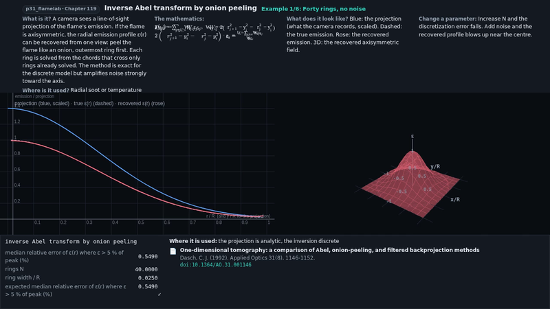
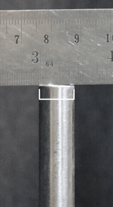
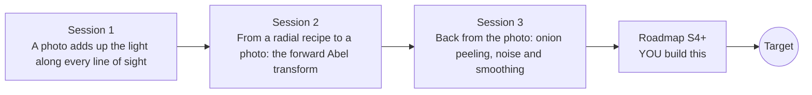

# openabel

[](https://github.com/KrunalPanchal1995/openabel/actions/workflows/ci.yml)   [](https://colab.research.google.com/github/KrunalPanchal1995/openabel/blob/main/sessions/session-01/lesson.ipynb) [](https://krunalpanchal1995.github.io/openabel/)

**Recover a 3D flame slice from one 2D photo, in three sessions.**

openabel teaches the Abel transform, the mathematics that turns a flat photo of a round flame into its glowing inside, using only Python and a browser.

- **Start from a glowing ball.** Session 1 needs only school geometry (Pythagoras) and shows what a camera really records.
- **See the noise problem for yourself.** Session 3 measures how inversion amplifies noise and how smoothing trades it for bias.
- **Know you got it right.** Each session ends with a checkpoint that prints PASS or FAIL against hand calculations and an exact analytic pair.
- **Build the missing half.** The repo stops at Session 3 on purpose; the roadmap shows the path to the Target.

[Target](#the-target) · [Who is this for](#who-is-this-for) · [Quick start](#quick-start) · [Sessions](#sessions) · [Roadmap](#roadmap) · [Contribute](#contribute) · [Explainer PDF](docs/explainer.pdf)

> **This repo is incomplete on purpose.** Sessions 1 to 3 are here and fully working. The finished Target below is a preview of what the community can build next. We show you the path, not the code. Sessions 4 and up are yours.

## The Target

A noisy side-view photo of a candle-like flame (top left, 3 percent noise) is turned back into the flame's inside. Plain onion peeling (middle left) is streaky and wrong near the axis; a smoothed inversion with an automatically chosen strength (bottom left) is clean, and the result is shown as a rotating 3D cut-away on the right. Your goal over the coming sessions: build the clean version yourself, then take it into 3D.



*Target: a noisy 2D photo, onion peeling, a smoothed inversion and a 3D cut-away (animated)*

- [Math Visual Studio: inverse Abel transform by onion peeling (video)](promo/media/onion_peeling.mp4)



*Math Visual Studio, Atlas S119: projection, true and recovered emission*



*FlameLab: a real burner flame tracked frame by frame*

Try it live:

- [Math Visual Studio: inverse Abel transform by onion peeling (Atlas S119)](https://krunalpanchal1995.github.io/studio/#atlas?ch=S119&ex=1)
- [Math Visual Studio: open the Studio](https://krunalpanchal1995.github.io/studio/)

How the Target was made is shown only as a path in [promo/roadmap.md](promo/roadmap.md).

## Who is this for
**higher secondary to advanced undergraduate (levels 4-6).** Topic area: Statistics, Research and Experimental Methods.

Prerequisites:

- Pythagoras' theorem and the idea of a circle's radius (school geometry); Session 2 uses sums, square roots and the exponential function.
- Python 3.10 or newer; if `python --version` works, you are ready. PRIMER.md explains the rest.
- No prior GitHub, calculus of integrals or image-processing experience is needed; integrals are introduced as sums.

New to Python? Read [PRIMER.md](PRIMER.md) first (10 minutes).

## Quick start

No installation knowledge needed. You need [Git](https://git-scm.com/downloads) and [Python 3.10+](https://www.python.org/downloads/) (Windows: tick "Add Python to PATH"). On Mac and Linux type `python3` wherever this page says `python`.

```bash
git clone https://github.com/KrunalPanchal1995/openabel.git
cd openabel
python start.py 1
```

`start.py` creates a private environment, installs what is needed and runs Session 1 with its checkpoint. Next: `python start.py 2`, `python start.py 3`, or `python start.py test` to check everything. Only a checkpoint: `python start.py check 1`.

Four lines turn the idea of Session 1 into a result (they work as they are): Save it as `try.py` and run it with `python start.py run try.py` (this uses the private environment, where NumPy is installed):

```python
import numpy as np
u = np.linspace(0, 3, 3001)                     # steps along one line of sight (mm)
f = np.exp(-(1.0 ** 2 + u ** 2))                # glow eps = exp(-r^2) on a line 1 mm off the axis
print(round(2 * f.sum() * (u[1] - u[0]), 3))    # -> 0.652 = sqrt(pi)/e, what that pixel records
```

Every session also opens in your browser with sliders (no install): [live apps](https://krunalpanchal1995.github.io/openabel/). Or use the Colab badge above for the notebook.

## Sessions

| # | Session | Model level | Time | Live app |
|---|---|---|---|---|
| 1 | [A photo adds up the light along every line of sight](sessions/session-01/README.md) | Level 1: conceptual interactive model | 60 min | [open](https://krunalpanchal1995.github.io/openabel/session-01/) |
| 2 | [From a radial recipe to a photo: the forward Abel transform](sessions/session-02/README.md) | Level 2: mathematical engineering model | 75 min | [open](https://krunalpanchal1995.github.io/openabel/session-02/) |
| 3 | [Back from the photo: onion peeling, noise and smoothing](sessions/session-03/README.md) | Level 3: simulation and validation | 90 min | [open](https://krunalpanchal1995.github.io/openabel/session-03/) |

Each session follows the same six steps: A real-world problem, B concept and theory, C visual explanation, D interactive simulation, E worked example and experiment, F assessment and design challenge. Each ends with `checkpoint.py`, which prints `PASS` or `FAIL` against reference numbers. Session 3 also contains the real-world mini-project: **Recover the inside of a candle-like flame from a synthetic photo**.

## Architecture



| Folder or file | What is inside |
|---|---|
| `sessions/` | three sessions: README (A-F), `lesson.py`, notebook, live app, exercises, activity sheet, checkpoint |
| `promo/` | the Target: media, live links, and the roadmap (path only) |
| `docs/` | `explainer.tex` and the built `explainer.pdf` |
| `tests/` | runs every lesson and checkpoint headless |
| `start.py` | one command to set up and run anything |
| `QUALITY.md`, `RUBRIC.md` | the quality checklist and the scoring rubric |
| `.github/` | CI, PDF build, Pages deploy, issue and PR templates |

## Roadmap

| Milestone | What you will build | Difficulty |
|---|---|---|
| Session 4: Choose the smoothing from the photo alone | A function that selects lam from a single noisy photo, replacing the grid search that peeks at the true profile. | intermediate |
| Session 5: Find the flame axis | An axis finder with sub-pixel accuracy, used before the inversion. | intermediate |
| Session 6: Use both sides and neighbouring rows | A whole-image inversion of all 20 rows with less noise than row-by-row inversion. | advanced |
| Session 7: Keep the hollow base hollow | An inversion that keeps the dark core of the candle base without negative values. | advanced |
| Session 8: Render it in 3D and animate | A looping 3D cut-away animation of the recovered flame. | advanced |

Full detail with a checkpoint per milestone: [promo/roadmap.md](promo/roadmap.md).

## Contribute
New to GitHub? Read [CONTRIBUTING.md](CONTRIBUTING.md); it starts from zero. Pick an issue labelled `good first issue`. Translations into Hindi, Telugu, Tamil and Malayalam are welcome.

<details>
<summary>Development</summary>

```bash
python start.py test        # runs every lesson and checkpoint
```
Lessons use `# %%` cell markers so they open as notebooks in VS Code. See [QUALITY.md](QUALITY.md) for the standard every session meets.
</details>

## License
MIT. See [LICENSE](LICENSE). Media in `promo/media` is (c) Krunal Panchal, CC BY 4.0.

## Acknowledgments
Part of the [PAN IIT OSS](https://hellofoss.tech-iitb.org/projects) open-source teaching collection, modelled on the structure of [openspline](https://github.com/openspline/openspline). Built on ideas from the Math Visual Studio at https://krunalpanchal1995.github.io/studio/.
