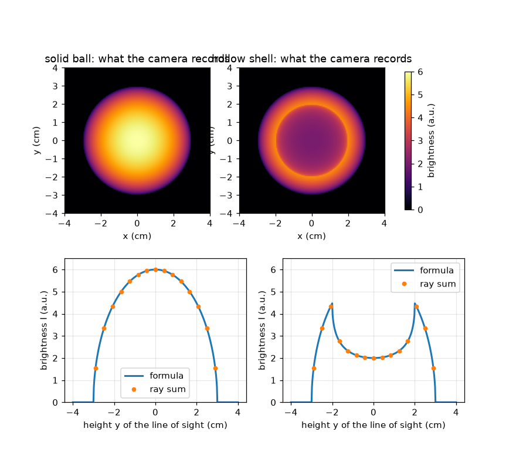
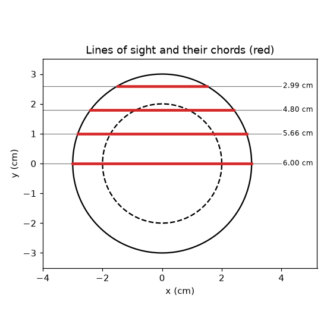

# Session 1: A photo adds up the light along every line of sight

*Level 1 (conceptual interactive model) · about 60 minutes · openabel*

> This is a simplified educational model. It is not a validated design tool and must not be used for real structures, electrical installations, vehicles, industrial processes or medical decisions.

**Prerequisites**

- Pythagoras' theorem.
- You have read PRIMER.md and run `python start.py 1` once.

**Learning objectives.** After this session you can:

- Explain why one camera pixel records a sum along a whole line of sight, not one point.
- Compute the chord length through a ball and the brightness profile of a uniformly glowing ball.
- Check a formula against a brute-force sum along a ray.
- Explain why a hollow glowing shell looks brightest near its edge.

## A. Real-world problem
A candle flame is a 3D glowing blob, but a photo of it is flat. Each pixel does not see one point of the flame: it sees all the light made along the line from the camera through the flame. How bright is a pixel when we look at a glowing ball from the side, and why does a hollow ball look different from a solid one? (This is general education about imaging, not a measurement method for any safety decision.)

## B. Concept and theory
Look at a ball of radius R from the side. A line of sight at height y above the middle passes through the ball along a straight segment called the chord. If the ball glows equally everywhere with emission eps0 (light made per centimetre of path, in arbitrary units a.u. per cm), the pixel records eps0 times the chord length. Pythagoras on the right triangle (half chord, y, R) gives the chord. For a hollow shell with empty inner radius r_in, subtract the chord through the hole. Adding up a quantity along a line is called a line integral; here emission is constant, so it is just emission times length.

| Symbol | Meaning | Unit |
|---|---|---|
| R | outer radius of the ball | cm |
| r_in | inner radius of the empty hole (0 for a solid ball) | cm |
| y | height of the line of sight above the middle | cm |
| eps0 | emission: light made per cm of path | a.u. per cm |
| I(y) | brightness recorded by the pixel at height y | a.u. |

**Assumptions**

- The object is a perfect ball with the same glow everywhere inside the glowing region.
- The object is transparent: light made on the way is not absorbed or scattered.
- The camera looks along parallel lines of sight (a distant, ideal camera).

$$ \mathrm{chord}(y,R)=2\sqrt{R^2-y^2}\quad(|y|<R),\qquad 0\ \text{otherwise} $$

$$ I(y)=\varepsilon_0\,\mathrm{chord}(y,R)\quad\text{(solid ball)} $$

$$ I(y)=\varepsilon_0\big(\mathrm{chord}(y,R)-\mathrm{chord}(y,r_\mathrm{in})\big)\quad\text{(hollow shell)} $$

## C. Visual explanation
The first figure shows the camera photo of a solid ball (brightest in the middle, 6 a.u. for eps0 = 1 a.u. per cm and R = 3 cm) next to a hollow shell with inner radius 2 cm: the shell has a darker middle (2 a.u.) and a bright ring at y = 2 cm (4.47 a.u.). Below each photo is the brightness profile; the dots are a brute-force sum along rays and sit exactly on the formula. The second figure draws four lines of sight through the ball with their chord lengths in red: the line through the middle is longest, the line near the edge is short.

*Camera photos and brightness profiles of a solid glowing ball and a hollow shell (dots: brute-force ray sums).*

*Four lines of sight through a ball and their chord lengths (red).*

## D. Interactive simulation
Run the lesson (`python start.py 1`), then open the live app: [Session 1: a glowing ball seen from the side](https://krunalpanchal1995.github.io/openabel/session-01/) (or `app.html` in this folder). Move the line-of-sight slider and watch the red chord and the brightness dot on the profile; then raise the hollow percentage and see the dark centre appear.

**Challenge.** Make the brightness at the centre of the profile at most half of the brightest point (use the hollow slider).

## E. Worked example and experiment
**Problem.** A solid ball of radius R = 3 cm has emission eps0 = 2 a.u. per cm. What does the camera record on a line of sight at y = 1.8 cm?

1. Square the numbers: R^2 = 9 and y^2 = 3.24.
2. R^2 - y^2 = 5.76 and its square root is 2.4 cm.
3. The chord is 2 * 2.4 = 4.8 cm.
4. Brightness = eps0 * chord = 2 a.u. per cm * 4.8 cm = 9.6 a.u.
5. Sanity check: the centre line would give 2 * 3 * 2 = 12 a.u., larger than 9.6 as it must be, and the units (a.u. per cm times cm) give a.u.

**Answer.** The chord is 4.8 cm and the pixel records 9.6 a.u.

**Experiment.** Look at a frosted (opal) light bulb or a ping-pong ball lit from inside in a dark room, photographed from the side with a phone. The middle looks brightest for a solid glow. A real bulb differs from the model because the glass scatters and absorbs light and the camera brightness is not linear; the model is exact only for an ideal transparent glow.

## F. Assessment and design challenge
**Question type A: Conceptual.** Why is the middle of a solid glowing ball the brightest pixel, and why can a hollow shell be brighter at its edge than in the middle?

Hint

Compare the path lengths through glowing material for a line through the middle and a line near the edge of the hole.

Step-by-step solution

The pixel adds up light along the path, so a longer path through glowing material gives a brighter pixel. In a solid ball the line through the middle is the longest. In a shell the middle line spends most of its length in the empty hole, so only the short walls count; a line that just grazes the hole travels a long way inside the wall, so the brightest line is the one that touches the inner radius.

**Question type B: Numerical.** A solid ball has R = 2.5 cm and eps0 = 1.2 a.u. per cm. Find the chord and the brightness at y = 1.5 cm, and at y = 0. Check the units.

Hint

Use chord = 2 sqrt(R^2 - y^2): at y = 1.5, R^2 - y^2 = 6.25 - 2.25 = 4.

Step-by-step solution

At y = 1.5 cm: chord = 2 * sqrt(4) = 4 cm and I = 1.2 * 4 = 4.8 a.u. At y = 0: chord = 2R = 5 cm and I = 1.2 * 5 = 6.0 a.u. Units: (a.u. per cm) times cm = a.u. Sanity: the off-centre line is shorter so it is dimmer.

**Question type C: Graph and simulation interpretation.** In the profile of the hollow shell (R = 3 cm, r_in = 2 cm), where is the brightest point and what value does it have? Why is the centre only 2 a.u.?

Hint

The brightest line touches the inner circle: y = r_in. Evaluate 2 sqrt(R^2 - r_in^2).

Step-by-step solution

The brightest point is at y = 2 cm with I = 2 sqrt(9 - 4) = 2 sqrt(5) = 4.47 a.u. The centre line has chord 6 cm through the outer ball minus 4 cm through the hole, so 2 cm and I = 2 a.u. The profile therefore has a dip in the middle and two bright shoulders, called limb brightening.

**Question type D: Design and optimisation challenge.** Design: a glowing shell has outer radius 3 cm. Choose the inner radius so that the centre brightness is at most half of the brightest brightness. Is a hole of radius 1 cm enough? Justify with a calculation.

Hint

The ratio I(0) / I_max = sqrt((R - r_in) / (R + r_in)). Set it to 1/2.

Step-by-step solution

I(0) / I_max = sqrt((R - r_in) / (R + r_in)) <= 1/2 means (R - r_in) / (R + r_in) <= 1/4, so r_in >= 0.6 R = 1.8 cm. A hole of 1 cm is not enough: the ratio is sqrt(2/4) = 0.71. With r_in = 2 cm the ratio is sqrt(1/5) = 0.45, which works. Trade-off: a bigger hole gives a stronger dark centre but a thinner glowing wall, so the whole image is dimmer.

Score yourself with [RUBRIC.md](../../RUBRIC.md). Print the [activity sheet](activity_sheet.md) to work on paper.

## Common misconceptions
| Common misconception | What is actually true |
|---|---|
| A pixel records the glow at one point of the object. | A pixel records the sum of the glow along the whole line of sight through the object. |
| A dark centre in the photo means there is no glow in the middle of the object. | A dark centre can mean a hollow centre, but only if the shape is known; a pure line integral alone does not say how the glow is spread along the line. |
| The brightest pixel is where the glow is strongest. | It is where the path through glowing material is the longest or strongest in total; for a shell that is at the inner edge, not where the emission is largest. |

## Glossary
- **line of sight**: the straight line from a camera pixel through the object
- **chord**: the straight segment where a line of sight is inside a circle or ball
- **emission**: light made per unit length of path inside the object
- **line integral**: adding up a quantity along a line; here emission times length
- **limb brightening**: a profile that is brighter near the edge of a hollow object than in its middle

## Finish
1. Do the three coding tasks in [exercises.md](exercises.md).
2. Run `python start.py 1` again after your changes. It ends with the checkpoint; when it prints `PASS`, you are done. (Checkpoint only: `python start.py check 1`.)

Next: [Session 2](../session-02/README.md)
