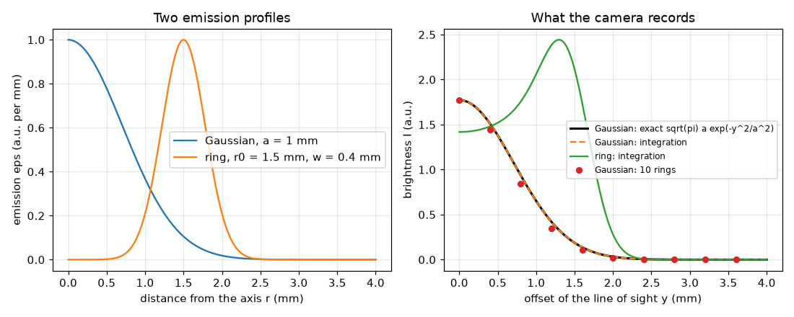
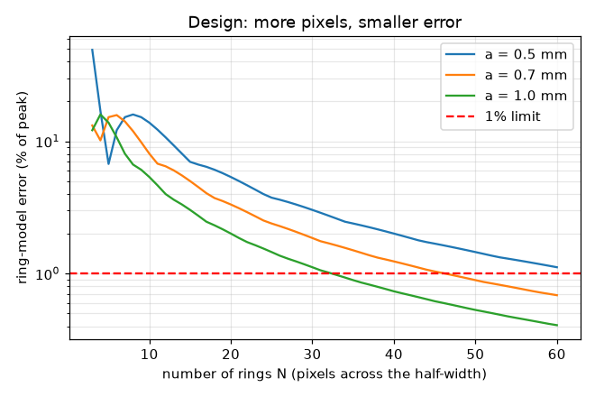

# Session 2: From a radial recipe to a photo: the forward Abel transform

*Level 2 (mathematical engineering model) · about 75 minutes · openabel*

> This is a simplified educational model. It is not a validated design tool and must not be used for real structures, electrical installations, vehicles, industrial processes or medical decisions.

**Prerequisites**

- Session 1: line of sight and chords.
- The exponential function exp(x); reading a sum written with a sigma symbol is explained in Section B.

**Learning objectives.** After this session you can:

- Write the forward Abel transform of a radial emission profile as an integral along a line of sight.
- Compute it by numerical integration and check it against the exact pair Gaussian to Gaussian.
- Build the ring (matrix) version of the transform and explain why the matrix has zeros below the diagonal.
- Estimate how many pixels across a flame are needed for a given accuracy.

## A. Real-world problem
A real flame does not glow equally everywhere: it may glow in a bright core, or in a hollow ring around a dark centre. We describe it by an emission profile eps(r): the light made per millimetre of path at distance r from the axis. If we know eps(r), what will the camera record? And since a camera has a limited number of pixels, how many pixels across the flame do we need before our model of the photo is accurate to 1 percent?

## B. Concept and theory
Take a line of sight at offset y from the axis. Walk along it a distance u from its closest point to the axis: there the distance from the axis is r = sqrt(y^2 + u^2). Adding the glow along the whole line (both directions) gives the brightness I(y); we keep only the region r < R, where the flame lives. This map from eps(r) to I(y) is the forward Abel transform. The integral can be written with u (no division by zero, so the trapezoid rule works). For a Gaussian eps = exp(-r^2/a^2) (a is its width) the answer is exactly a Gaussian again, I = sqrt(pi) a exp(-y^2/a^2). A camera works with pixels, so we cut the region into N rings of width dr = R/N and assume eps is constant in each ring. The line of sight at y_i = i dr crosses ring j (for j >= i) along the length W_ij; then I_i is the sum over j of W_ij eps_j, which is a matrix times a vector. Lines of sight at y_i never meet rings inside y_i, so W is zero below its diagonal.

| Symbol | Meaning | Unit |
|---|---|---|
| eps(r) | emission at distance r from the axis | a.u. per mm |
| I(y) | brightness recorded at offset y | a.u. |
| u | distance along the line of sight from its closest point to the axis | mm |
| R | outer radius of the modelled region (4 mm) | mm |
| a | width of the Gaussian flame | mm |
| N, dr | number of rings and ring width R/N | no unit, mm |
| W_ij | path length of line of sight i inside ring j | mm |

**Assumptions**

- The flame is exactly round about its axis and transparent.
- Emission is zero beyond r = R (for the Gaussian this is a tiny truncation: exp(-16) at R = 4 a with a = 1 mm).
- Emission is constant inside each ring (the ring model); the pixels sample at y_i = i dr.

$$ I(y)=2\int_0^{\sqrt{R^2-y^2}}\varepsilon\!\left(\sqrt{y^2+u^2}\right)\mathrm{d}u=2\int_y^{R}\frac{\varepsilon(r)\,r\,\mathrm{d}r}{\sqrt{r^2-y^2}} $$

$$ \varepsilon(r)=e^{-r^2/a^2}\ \Longrightarrow\ I(y)=\sqrt{\pi}\,a\,e^{-y^2/a^2} $$

$$ W_{ij}=2\left(\sqrt{r_{j+1}^2-y_i^2}-\sqrt{\max(r_j^2-y_i^2,0)}\right),\qquad I_i=\sum_{j\ge i}W_{ij}\,\varepsilon_j $$

## C. Visual explanation
The left figure shows two emission profiles: a Gaussian with a = 1 mm (brightest on the axis) and a ring-shaped flame with r0 = 1.5 mm and w = 0.4 mm (dark on the axis). The right figure shows what the camera records: the Gaussian gives a Gaussian (the numerical integration lies exactly on the exact curve), while the ring flame gives a profile with a dip on the axis and a bright shoulder near y = 1.5 mm. The red dots are the 10-ring model: they follow the curve but are visibly off. A second figure plots the ring-model error against the number of rings on a logarithmic axis: it falls steadily, and the red line marks 1 percent.

*Left: Gaussian and ring emission profiles. Right: the photo profiles; red dots are a 10-ring model.*

*Ring-model error against the number of rings, for three flame widths; the red line is the 1 percent limit.*

## D. Interactive simulation
Run the lesson (`python start.py 2`), then open the live app: [Session 2: the ring model of the photo](https://krunalpanchal1995.github.io/openabel/session-02/) (or `app.html` in this folder). Change the flame width a and the number of rings N and watch the red ring-model dots approach the exact blue curve; then read the error in the readout.

**Challenge.** Reach a ring-model error below 1 percent of the peak for a flame of width a = 0.5 mm or narrower.

## E. Worked example and experiment
**Problem.** For a Gaussian flame with a = 1 mm, what brightness does the camera record at y = 1 mm? Check it with numerical integration.

1. Use I(y) = sqrt(pi) a exp(-y^2 / a^2) with a = 1 and y = 1.
2. The exponent is -1^2 / 1^2 = -1, and exp(-1) = 0.3679.
3. sqrt(pi) = 1.7725, so I = 1.7725 * 0.3679 = 0.652 a.u.
4. Numerical check: integrate 2 exp(-(1 + u^2)) over u from 0 to 3 with the trapezoid rule; the code `abel_forward` gives 0.652.
5. Sanity check: the peak (y = 0) is sqrt(pi) = 1.77 a.u., so 0.652 is smaller, as it must be at a line of sight away from the axis.

**Answer.** I(1 mm) = sqrt(pi)/e = 0.652 a.u.; the numerical integral agrees.

**Experiment.** Photograph a small, steady light such as a candle or a glowing LED behind a diffusing blob of cotton wool in a dark room, with the camera far away, and read the pixel values across it. A soft round glow has a roughly Gaussian profile, and its photo profile is also roughly Gaussian, as in the pair above. The model differs from reality because the camera response is not linear (use a raw or low-gamma image), the glow is not perfectly round, and the light is partly absorbed or scattered by the material.

## F. Assessment and design challenge
**Question type A: Conceptual.** Why must the ring matrix W be zero below its diagonal? What does that mean for solving the inverse problem?

Hint

Which rings can the line of sight at y_i cross?

Step-by-step solution

A line of sight at offset y_i stays at a distance of at least y_i from the axis, so it can only cross rings whose outer edge is beyond y_i, that is rings j >= i. Rings inside y_i give W_ij = 0. Because W is triangular, the outermost line of sight meets only the outermost ring, the next one meets two rings, and so on: the inverse can be solved ring by ring from the outside inwards (onion peeling, Session 3).

**Question type B: Numerical.** A Gaussian flame has width a = 0.5 mm. What is the brightness at y = 0 and at y = 0.5 mm? Give the units and a sanity check.

Hint

I(y) = sqrt(pi) a exp(-y^2/a^2).

Step-by-step solution

At y = 0: I = 1.7725 * 0.5 = 0.886 a.u. At y = 0.5 mm: I = 0.886 * exp(-1) = 0.326 a.u. Units: eps in a.u. per mm times mm gives a.u. Sanity: a narrower flame has a smaller total (0.886 against 1.77 for a = 1 mm) and the value falls to 1/e = 37 percent of the peak at y = a.

**Question type C: Graph and simulation interpretation.** On the plot of ring-model error against N, how does the error change from N = 10 to N = 40 for a = 1 mm? Read the numbers and say what happens when the flame is narrower.

Hint

The checkpoint prints the exact values; the curves for a = 0.5 and a = 0.7 are above the one for a = 1.

Step-by-step solution

For a = 1 mm the error is 5.4 percent at N = 10, 2.0 percent at N = 20 and 0.7 percent at N = 40: it falls roughly like dr to the power 1.4 (each halving of the pixel size divides the error by about 2.7). Narrower flames have larger errors at the same N because the profile changes faster across a ring; the a = 0.5 mm curve needs about twice as many rings to reach the same error.

**Question type D: Design and optimisation challenge.** Design: a camera images a region 8 mm wide in total (R = 4 mm on each side of the axis). The flame is a Gaussian with a = 0.7 mm and you want the ring model accurate to 1 percent of the peak. How many pixels across the whole image (both sides) and what pixel size do you need? What happens if the flame is half as wide?

Hint

Use `smallest_rings(0.7)`; pixels across = 2N; pixel size = R / N.

Step-by-step solution

smallest_rings(0.7) = 47 rings, so the 8 mm wide image needs 2 * 47 = 94 pixels across, with pixel size 4 / 47 = 0.085 mm. For a = 0.5 mm the answer is 65 rings (pixel 0.062 mm); for a = 1 mm it is 33 rings (pixel 0.121 mm). In all three cases the pixel size is about 0.12 times the width a, that is about 8 pixels across one Gaussian width a. Trade-off: finer pixels need a closer or better camera and gather less light per pixel, which raises the noise (Session 3).

Score yourself with [RUBRIC.md](../../RUBRIC.md). Print the [activity sheet](activity_sheet.md) to work on paper.

## Common misconceptions
| Common misconception | What is actually true |
|---|---|
| The photo of a Gaussian flame is just a smaller Gaussian copy of it. | It is a Gaussian again with the same width a, but its peak is sqrt(pi) a instead of 1: the Abel transform of exp(-r^2/a^2) is sqrt(pi) a exp(-y^2/a^2). |
| A finer pixel always means a better result. | A finer pixel reduces the model error but collects less light, so noise rises; the best choice balances both (Session 3). |
| A ring-shaped flame gives a ring-shaped photo. | The photo of a ring flame has a dip on the axis and a bright shoulder near the ring radius, not a ring: it is a line integral. |

## Glossary
- **Abel transform**: the map from a radial profile eps(r) to the line-of-sight profile I(y) for a round object
- **radial profile**: a function of the distance from the axis only
- **ring model**: cutting the object into rings of constant emission so that the transform becomes a matrix
- **trapezoid rule**: approximating an integral by adding the areas of thin trapezoids
- **triangular matrix**: a matrix with all entries on one side of the diagonal equal to zero

## Finish
1. Do the three coding tasks in [exercises.md](exercises.md).
2. Run `python start.py 2` again after your changes. It ends with the checkpoint; when it prints `PASS`, you are done. (Checkpoint only: `python start.py check 2`.)

Next: [Session 3](../session-03/README.md)
