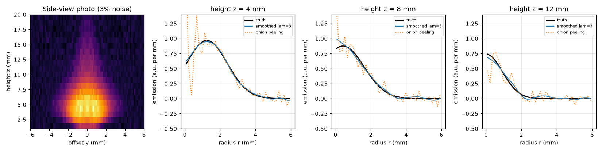
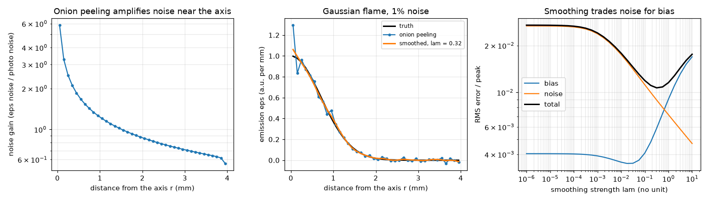
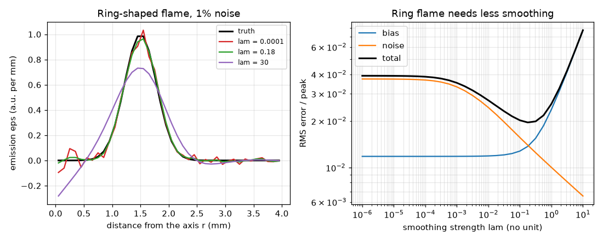

# Session 3: Back from the photo: onion peeling, noise and smoothing

*Level 3 (simulation and validation) · about 90 minutes · openabel*

> This is a simplified educational model. It is not a validated design tool and must not be used for real structures, electrical installations, vehicles, industrial processes or medical decisions.

**Prerequisites**

- Session 2: the ring matrix W.
- Session 1: line integrals.
- Matrix times vector; the idea of a standard deviation (explained in Section B).

**Learning objectives.** After this session you can:

- Recover a radial emission profile from a brightness profile by onion peeling and check it against an exact analytic pair.
- Measure how much the inversion amplifies noise, and where.
- Use a smoothed (Tikhonov) inversion and explain the trade-off between bias and noise.
- Recognise a failure case (over-smoothing a ring-shaped flame) and apply the method to a candle-like flame photo.

## A. Real-world problem
You have a photo of a flame and you want the glow of its inside, for example the radial profile of soot or temperature, not the sum along each line of sight. If the flame is round about its axis one photo is enough. But every real photo has a little noise, and the inversion makes it worse. How much worse, where, and what can you do about it without cheating? (This is a teaching model; real combustion diagnostics need calibration and many more checks.)

## B. Concept and theory
Session 2 gave I = W eps, with W upper triangular. Onion peeling solves it from the outside in: the outermost ring from the outermost pixel, then each inner ring after subtracting what the outer rings already explain. With perfect data this is exact for the ring model. With noise, errors accumulate towards the axis. Because the inversion is linear, eps = Winv I, so noise of standard deviation sigma on each pixel gives noise of sigma times the length of row i of Winv on ring i; call that length the noise gain. To tame the noise we ask for a smooth answer: minimise the misfit |W eps - I|^2 plus lam times the roughness |D eps|^2, where D takes second differences (zero for a straight-line profile). Large lam gives a smooth but biased profile, lam = 0 gives noisy onion peeling. The total error combines the bias (the average error) and the noise (the scatter): total^2 = bias^2 + noise^2. To avoid an inverse crime (testing with data made by the same approximation), the test photos are made by a fine numerical integral.

| Symbol | Meaning | Unit |
|---|---|---|
| eps_i | emission of ring i | a.u. per mm |
| I_i | brightness at offset y_i | a.u. |
| sigma | standard deviation of the photo noise (fraction of the peak brightness) | a.u. |
| gain_i | noise gain: noise in ring i divided by sigma | per mm |
| lam | smoothing strength (scaled so it has no unit) | no unit |
| bias, noise, total | RMS errors as a fraction of the peak emission | no unit |

**Assumptions**

- The flame is round about a known axis, steady and transparent.
- The photo noise is independent from pixel to pixel with the same size everywhere.
- The photo is linear in the emission (no saturation, no gamma curve).

$$ I_i=\sum_{j\ge i}W_{ij}\varepsilon_j\ \Longrightarrow\ \varepsilon_i=\frac{I_i-\sum_{j>i}W_{ij}\varepsilon_j}{W_{ii}} $$

$$ \mathrm{gain}_i=\Big(\sum_k (W^{-1})_{ik}^2\Big)^{1/2},\qquad \sigma_{\varepsilon,i}=\sigma\cdot\mathrm{gain}_i $$

$$ \hat{\varepsilon}=\arg\min_{\varepsilon}\ \|W\varepsilon-I\|^2+\lambda s\,\|D\varepsilon\|^2=(W^{\mathsf T}W+\lambda s D^{\mathsf T}D)^{-1}W^{\mathsf T}I $$

$$ \mathrm{total}^2=\mathrm{bias}^2+\mathrm{noise}^2 $$

## C. Visual explanation
The first figure has three panels for a Gaussian flame (a = 1 mm, 40 rings, 1 percent noise). Left: the noise gain of onion peeling is about 5.9 per mm at the axis ring and 0.56 per mm at the outer ring (log axis). Middle: the true profile, a ragged onion-peeled estimate and a smooth estimate that follows the truth. Right: bias rises with the smoothing strength lam while noise falls, and the total (black) has a minimum around lam of 0.3 to 0.6. The second figure repeats this for a ring-shaped flame: moderate smoothing recovers the ring, while heavy smoothing (lam = 30) flattens the peak and makes the dark centre negative. The third figure shows a candle-like synthetic photo with 3 percent noise and the recovered profiles at three heights.

*Synthetic candle photo with 3 percent noise and the recovered radial emission at three heights.*

*Gaussian flame, 1 percent noise: noise gain per ring, onion peeling versus smoothing, and the bias-noise trade-off.*

*Ring-shaped flame: three smoothing strengths and the bias-noise trade-off; heavy smoothing blurs and flattens the ring.*

## D. Interactive simulation
Run the lesson (`python start.py 3`), then open the live app: [Session 3: noise and smoothing in the inversion](https://krunalpanchal1995.github.io/openabel/session-03/) (or `app.html` in this folder). Slide the smoothing strength from tiny to large on the Gaussian flame and watch the grey noise band shrink while the blue average profile moves away from the black truth; then switch to the trade-off graph and find the minimum of the black curve.

**Challenge.** For the Gaussian flame at 1 percent noise or more, find a smoothing strength that keeps the total error at or below 1.2 percent of the peak.

## E. Worked example and experiment
**Problem.** Three rings of width 1 mm (R = 3 mm) give measured brightness I = (12, 9.121, 4.472) a.u. at y = 0, 1 and 2 mm. Recover the emission of each ring by onion peeling.

1. The ring matrix (Session 2 formula) has rows (2, 2, 2), (0, 3.464, 2.192) and (0, 0, 4.472).
2. Outermost ring first: eps_2 = 4.472 / 4.472 = 1.
3. Next ring: eps_1 = (9.121 - 2.192 * 1) / 3.464 = 6.929 / 3.464 = 2.
4. Innermost ring: eps_0 = (12 - 2 * 2 - 2 * 1) / 2 = 6 / 2 = 3.
5. Check by the forward model: 2*3 + 2*2 + 2*1 = 12, 3.464*2 + 2.192*1 = 9.120 and 4.472*1 = 4.472, which reproduce the measured values.

**Answer.** The emission is (3, 2, 1) a.u. per mm, from the axis outwards.

**Experiment.** Photograph a candle in a dark room with a phone fixed on a tripod (take video, never leave a flame unattended, adult supervision for young learners), and take two photos a moment apart. The difference between two frames of the same steady flame shows the size of the photo noise. Peeling a row near the middle of the flame shows the dark wax-vapour core. Model versus reality: a real flame flickers and drifts (it is not perfectly steady or round), a phone applies a non-linear brightness curve and may saturate, and the light is partly absorbed by soot; the inversion assumes none of this.

## Real-world application and mini-project: Recover the inside of a candle-like flame from a synthetic photo
A lab gives you a synthetic side-view photograph of a candle-like flame with 3 percent noise (`candle_photo(N=40, frac=0.03)` in Session 3). The flame is hollow near its base and fills in higher up. Recover the radial emission at three heights (z = 4, 8 and 12 mm) with `invert_row`, trying the smoothing strengths in `LAM_GRID`, and choose the one with the smallest worst-row error. Because this is a synthetic photo, the true emission `candle_emission` is known, so you can score each choice.

**Deliverable:** A script that prints the worst-row error for every strength in `LAM_GRID`, names the best strength, and saves a figure with the photo and the true, onion-peeled and smoothed profiles at the three heights.

**Success looks like:** Plain onion peeling (lam = 0) has a worst-row error above 0.25 of the peak, and the best strength on the grid (lam = 3) brings it below 0.05 (it is 0.041).

## F. Assessment and design challenge
**Question type A: Conceptual.** Why does the noise in the recovered emission grow towards the axis, and why does smoothing help but not for free?

Hint

Think about how many pixels' errors are added up in the innermost ring.

Step-by-step solution

Each inner ring is found by subtracting the contribution of all outer rings from the pixel, so the errors of all the outer solutions pile up, and then they are divided by W_ii = 2 dr sqrt(2i + 1), which is smallest for the axis ring (i = 0). The noise gain is about 5.9 per mm at the axis and 0.56 per mm at the edge (N = 40). Smoothing averages neighbouring rings, which cancels random noise, but it also averages real structure, so sharp features (a peak, a hole) are lowered and blurred: this is the bias. The total error is smallest when the two are balanced.

**Question type B: Numerical.** For N = 40 rings the noise gain of the axis ring is 5.9 per mm. The photo noise is sigma = 0.02 a.u. What is the noise in the emission of the axis ring? Compare with a Gaussian flame whose peak emission is 1 a.u. per mm.

Hint

noise = sigma * gain; then divide by the peak.

Step-by-step solution

noise = 0.02 a.u. * 5.9 per mm = 0.12 a.u. per mm. Relative to the peak of 1 a.u. per mm that is 12 percent, six times the 2 percent noise of the photo. The outer ring has gain 0.56 per mm and noise 0.011 a.u. per mm (1 percent). Units: a.u. times per mm is a.u. per mm, the unit of the emission.

**Question type C: Graph and simulation interpretation.** On the trade-off graph of the Gaussian flame at 1 percent noise, how do the bias, noise and total change as lam goes from 0.00001 to 30? Where is the minimum of the total?

Hint

Move the log10 lam slider in the app or read the third panel of the figure.

Step-by-step solution

The bias is flat at about 0.4 percent for small lam and rises to about 1.9 percent at lam = 30. The noise falls steadily from about 2.7 percent to about 0.4 percent. The total is about 2.7 percent for tiny lam, falls to a minimum of about 1.1 percent near lam = 0.3 (log10 lam = -0.5), then rises again as the bias takes over. The best choice is the one at the valley, not the largest lam.

**Question type D: Design and optimisation challenge.** Design: a ring-shaped flame (r0 = 1.5 mm, w = 0.4 mm) is photographed with 1 percent noise and 40 rings. Choose between lam = 0.01, 0.1 and 10 and give the total error of each (use `bias_noise_exact`). What risk does the largest lam bring for a hollow flame?

Hint

Print `bias_noise_exact(lambda q: ring_eps(q, 1.5, 0.4), 40, lam, 0.01)` for the three values.

Step-by-step solution

The total errors are about 2.7 percent for lam = 0.01 (noise dominates), 2.0 percent for lam = 0.1 (best) and 7.7 percent for lam = 10 (bias dominates). Choose lam = 0.1. With lam = 10 or more, smoothing lowers the ring peak and fills or even drives negative the dark hole on the axis, so the flame would be misread as less hollow and with negative emission, which is unphysical. Trade-off: a ring flame needs less smoothing than a Gaussian flame because it has sharper structure.

Score yourself with [RUBRIC.md](../../RUBRIC.md). Print the [activity sheet](activity_sheet.md) to work on paper.

## Common misconceptions
| Common misconception | What is actually true |
|---|---|
| Onion peeling is exact, so it is the best method. | It is exact only for noise-free data of the ring model; with real noise it amplifies the noise, most of all near the axis. |
| Smoothing removes noise without any cost. | Smoothing trades noise for bias: it lowers peaks and fills holes. The best strength balances the two. |
| If a method recovers a made-up profile from data made by the same model, it is validated. | That is an inverse crime and looks better than reality. Test with data made by an independent (finer) calculation and against an exact pair. |
| A flame photo always gives the inside of the flame. | Only if the flame is round about a known axis, steady and transparent; a flickering or tilted flame breaks the assumption. |

## Glossary
- **inverse problem**: finding the cause (emission) from the effect (photo)
- **onion peeling**: solving the ring matrix from the outermost ring inwards
- **noise gain**: how much the inversion multiplies the photo noise in a given ring
- **regularisation (Tikhonov)**: adding a penalty for roughness to get a stable, smooth solution
- **bias**: the average error of an estimate
- **inverse crime**: testing a method on data made by the same model it uses

## Finish
1. Do the three coding tasks in [exercises.md](exercises.md).
2. Run `python start.py 3` again after your changes. It ends with the checkpoint; when it prints `PASS`, you are done. (Checkpoint only: `python start.py check 3`.)

Next: the [roadmap](../../promo/roadmap.md). Session 4 is yours to build.
